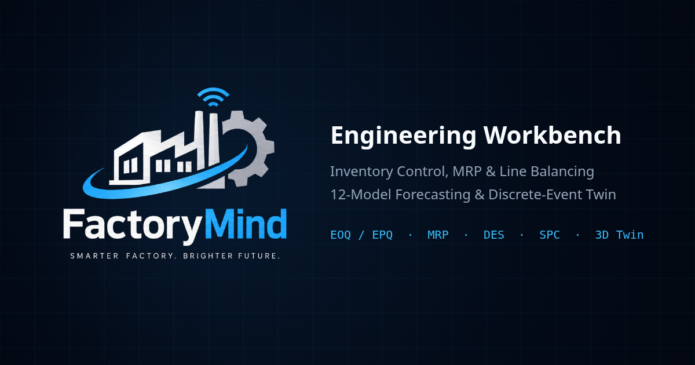

# FactoryMind — Industrial & Production Engineering Workbench



[](https://github.com/Ibtasham/FactoryMind/actions/workflows/deploy.yml)
[](https://ibtasham.github.io/FactoryMind/)

**Made by Md Ibtashamur Rahman**

FactoryMind is a browser-based Industrial & Production Engineering (IPE) decision-support platform built with **React 19, TypeScript, Vite, Tailwind CSS v4, Three.js, and jsPDF**. All mathematical engines execute purely in TypeScript with zero DOM coupling and are verified by automated unit tests (`node --test` via `tsx`).

---

## Project Snapshot

<!-- FACTORYMIND:AUTO-STATUS:START -->
<!-- Updated by scripts/update-readme.ts on push -->

| Item | Status |
| :--- | :--- |
| Live Deployment | [ibtasham.github.io/FactoryMind](https://ibtasham.github.io/FactoryMind/) |
| Engineering Engines | 22 TypeScript solver modules (`src/engine/`) |
| Workbench Modules | 20 interactive views (`src/pages/`) |
| Automated Verification | 118 unit & integration tests across 14 suites |
| Latest Sync | `main` @ `workspace` (2026-11-25) |

<!-- FACTORYMIND:AUTO-STATUS:END -->

---

## Core Engineering Modules

1. **Inventory Control & Policy (`src/engine/ipe.ts`, `src/engine/advisor.ts`)**
   - Classical **Wilson EOQ**, finite-rate **EPQ**, and **Quantity Discount** price-break optimizer.
   - **Reorder Point (ROP) & Safety Stock** with OLS-detrended residual demand variance (`dailyStats`) and fallback $\sigma$ tracking.
   - **ABC / Pareto Classification**, working-capital **Portfolio Advisor**, and **Executive Brief** policy simulator.

2. **Demand Forecasting, Research Lab & Smart Alerts (`src/engine/forecast.ts`, `src/engine/researchBenchmark.ts`, `src/engine/smartAlerts.ts`)**
   - 12-model chronological cross-validation suite: SMA, WMA, SES, Holt Linear, Additive/Multiplicative Holt-Winters, Seasonal Naive, Linear Trend, Croston, SBA, plus Naive and Mean baselines.
   - Reproducible **Research Lab** supporting expanding/rolling origins, zero-leakage causal perturbation checks, scale-free metrics (WAPE, median WAPE, IQR, MASE, sMAPE, zero-adjusted MAPE, Bias), provenance separation, and JSON/Config/Markdown benchmark exports with independent replay verification.
   - Horizon-widened 95% prediction intervals and **Predictive Stockout Smart Alerts** synced across Dashboard, Header Bell Popover, and Store preferences.

3. **Stochastic Simulation, Newsvendor & Queueing (`src/engine/inventory.ts`, `src/engine/prodsim.ts`)**
   - **Monte Carlo $(Q, R)$ Inventory Simulator & Grid Optimizer** supporting multi-order pipeline concurrency, Normal/Poisson/Lognormal/Gamma/Constant demand, stochastic lead times, and high-CV Normal truncation warnings.
   - **Discrete-Event Production Line Simulation (`simulateProductionLine`)** modeling serial workstations, finite inter-station buffers (blocking/starvation), MTBF/MTTR equipment downtime, bottleneck telemetry, and Little's Law ($L = \lambda W$) verification.
   - **Single-Period Newsvendor** and analytical **Queueing Calculators** ($M/M/c$ Erlang-C, $M/M/c/K$ finite capacity, $M/G/1$ Pollaczek–Khinchine).

4. **Multi-Level MRP, Line Balancing & SPC (`src/engine/mrp.ts`, `src/engine/linebal.ts`, `src/engine/ipe.ts`)**
   - Low-level-coded multi-level **MRP explosion** with scheduled receipts (open POs), lot sizing (L4L, FOQ, EOQ, POQ), conservative ceiling lead-time offsetting, and shortage/late-release alerts.
   - **Assembly Line Balancing** comparing 5 solvers (RPW, LCR, Kilbridge & Wester, COMSOAL, and Exact Branch & Bound) with shared workspace persistence.
   - **Statistical Process Control (SPC)**: Shewhart $\bar{X}/R$ charts, Western Electric Rules 1–3, Phase I & Phase II (OOC-excluded) $C_p/C_{pk}/P_p/P_{pk}$, and exact finite-horizon EWMA & CUSUM drift charts.

5. **Interactive 3D Digital Twin & Reports (`src/engine/threeModels.ts`, `src/engine/reports.ts`, `src/engine/pdfReport.ts`)**
   - Code-split **Three.js WebGL 3D Studio** featuring articulated BOM assemblies with exploded view inside project-matched workshop machine bays, plus a **Live Plant & Warehouse Twin** synced to catalog ROP status and DES line bottleneck/queue telemetry.
   - Formula-injection-hardened **CSV**, **Markdown**, and **multi-page jsPDF** operations dossier exports.

6. **Decision Intelligence Assistant & Optional Server-Side Gemini Explanation (`src/engine/decisionAssistant.ts`, `server.ts`)**
   - Pure TypeScript natural-language decision engine backed by validated FactoryMind solvers (`advisor.ts`, `smartAlerts.ts`, `mrp.ts`, `desEngine.ts`, `scenarioStudio.ts`), supporting SKU risk diagnosis, material delay ranking, inventory investment optimization, bottleneck relief analysis, counterfactual what-if scenarios, policy comparisons, and DES explanations.
   - Explicit **User Approval Gates** (field-by-field preview diffs) prevent unapproved mutations to stock balances, policy targets, or simulation settings.
   - Optional server-side **Gemini (`gemini-4-hydrogen`)** narrative synthesis via `server.ts` (`/api/assistant/explain`), strictly grounded on the computed numerical dossier; operates seamlessly in deterministic-only mode whenever `GEMINI_API_KEY` is unconfigured or hosted statically on GitHub Pages.

---

## Development & Verification

> **Note on Data Provenance**: The preloaded 17-SKU electromechanical catalog and synthetic demand series are illustrative engineering demo data designed for exploration and validation. Import your own CSV/JSON catalog in **Inventory** or **Settings** for live operational planning.

```bash
# Install dependencies
bun install

# Start full-stack Express + Vite server (port 3000)
bun run dev

# Run pure TypeScript engine, server & store test suite
bun run test

# Sync the README project snapshot section
bun run readme:update

# Type-check, static-check, run all unit/integration suites & build production bundle
bun run verify
```
